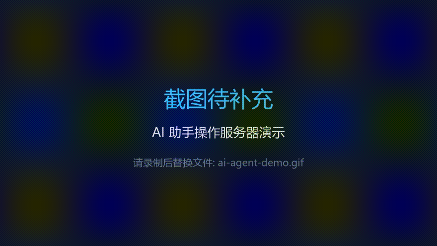
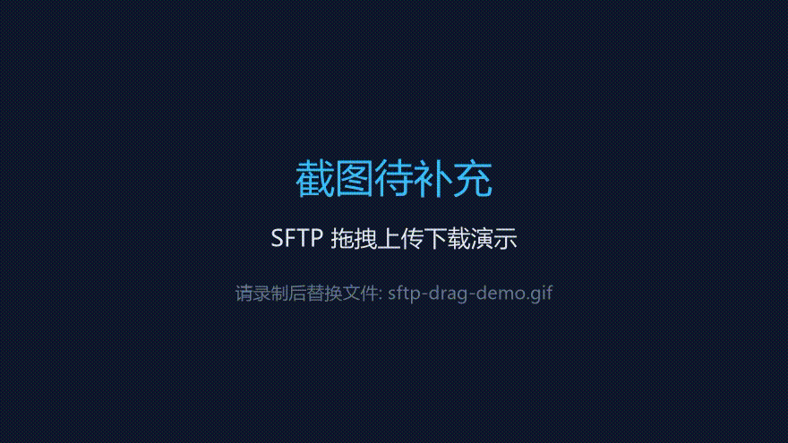
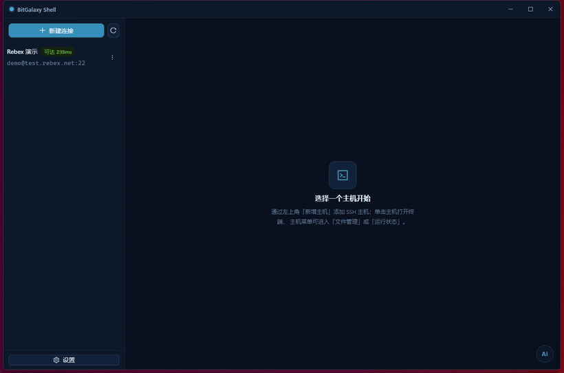
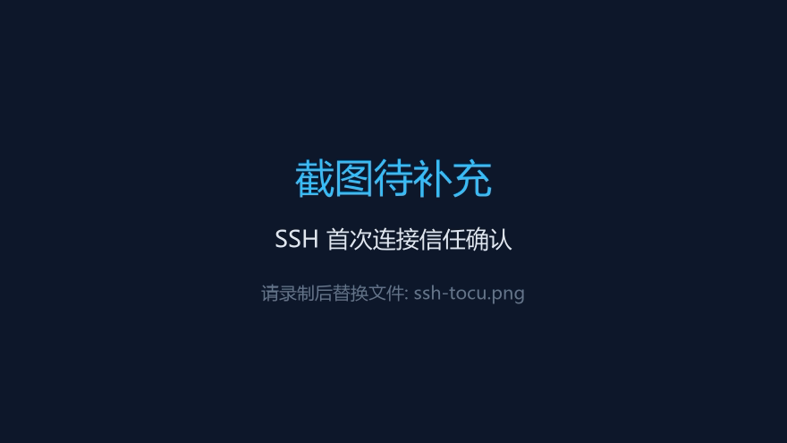
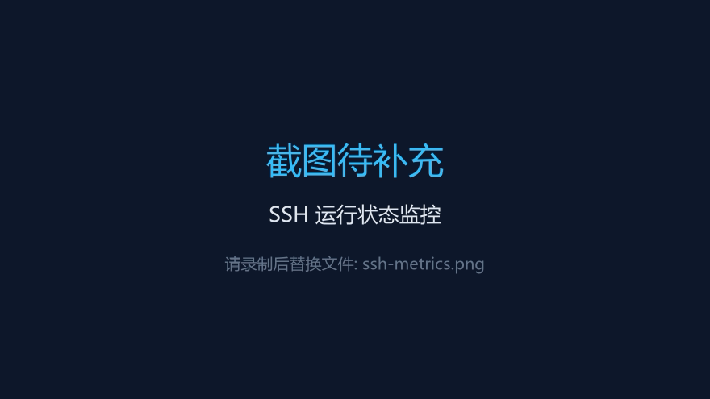
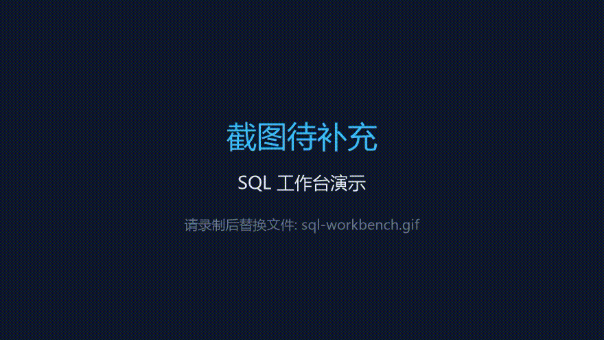
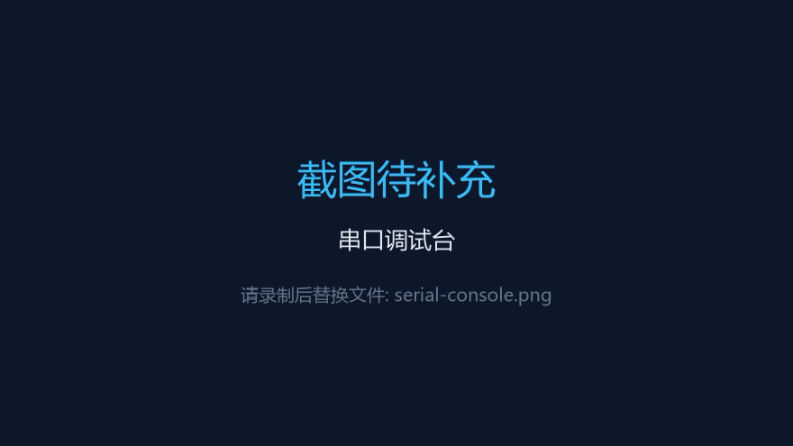
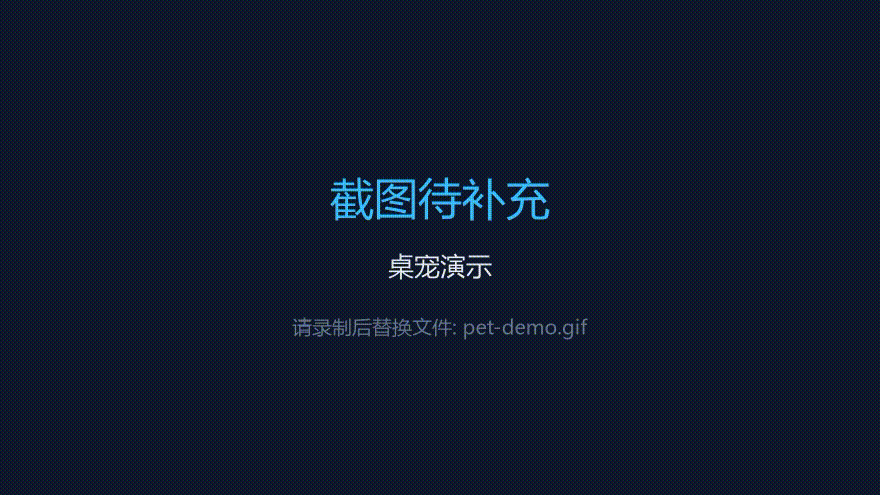
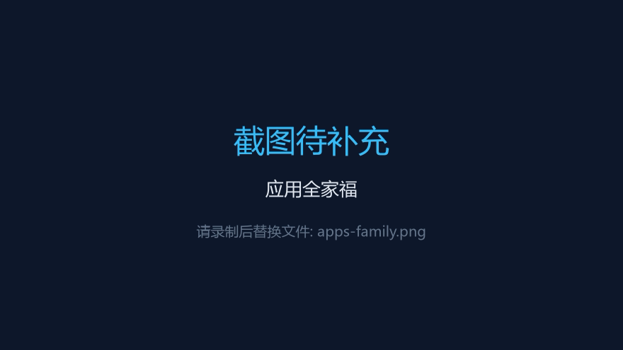

# BitGalaxy Shell

开源的 AI 原生开发者控制台：SSH 终端 · SQL 客户端 · 串口调试，三件套一个安装器搞定。

基于 Tauri 2 构建（Rust 后端 + React 前端），单安装器内含四个独立 EXE，当前面向 Windows 平台发布。


## 特色亮点

### AI 原生，不是"外挂 AI"

AI 不是聊天框，而是能直接干活的智能体：让它查日志、改配置、传文件，它在真实 SSH 连接上执行命令与 SFTP 操作，全程可视化卡片展示，敏感动作需人工批准（fail-closed，超时自动拒绝）。

<!-- 占位：AI 助手操作服务器的演示 GIF（建议 15~25s：输入指令 → AI 执行命令卡片 → 审批卡片 → 结果），放到 docs/images/ai-agent-demo.gif 后本行生效 -->


- 终端选中内容右键即问 AI，附上下文一键解析
- sudo 提权走安全卡片索取密码，仅内存缓存、不落盘
- 对话历史 SQLite 持久化，重启不丢；多会话管理
- 支持 MCP stdio，可接入自有工具链

### 桌面级 SFTP 体验

文件管理像本地资源管理器一样操作：从桌面直接拖文件进远端目录即上传，从面板拖出即下载（走系统下载协议，浏览器直接接管）；传输前预检体积、磁盘剩余、重名冲突。

<!-- 占位：SFTP 拖拽上传/下载演示 GIF（建议：本地拖入文件 → 进度 → 完成；或右键下载），放到 docs/images/sftp-drag-demo.gif 后本行生效 -->


- 断点续传（.part），大文件传一半断了接着传
- 重名三选：覆盖 / 自动重命名 / 取消；≥1GB 二次确认
- 错误细分类（权限 / 空间 / 网络等）并给出建议动作
- 多选批量下载 / 删除，双击目录进入、双击文件下载

### 工程级连接稳定性

从协议层处理半开连接与假死会话：

- 同主机共享一条 TCP，终端 / SFTP / 监控多通道复用，空闲自动回收
- 元数据操作 15s 快速失败 + 错误分类，死连接当场暴露而非拖到超时
- 断线自动重连，会话按 WS 代际清理，杜绝"界面显示已连、后端早已失效"的假连接
- TOFU 主机密钥确认、看门狗检测僵尸会话

## SSH 终端

真 PTY 终端多标签工作台（xterm.js），窗口尺寸实时同步远端，绝无字符错位。



<!-- 占位：如需更换更精炼的终端 GIF（建议 15s 内：连接 → ls → help），替换 docs/images/ssh-terminal-demo.gif 即可 -->

- 专注模式（Ctrl+Shift+F）：隐藏侧栏全宽终端，长命令不再折行
- 长输出折行智能标注（左侧竖线 + 续行前缀），复制不受影响
- 终端内右键菜单：复制 / 粘贴并发送 / 问 AI / 清屏
- 拖文件到终端直接上传（预检 + 进度卡片）

<!-- 占位：SSH 主机列表 + 信任弹窗截图（首次连接的 TOFU 指纹确认界面），放到 docs/images/ssh-tocu.png -->


<!-- 占位：主机运行状态监控面板截图（如 MetricsPane：CPU/内存曲线），放到 docs/images/ssh-metrics.png -->


## SQL 客户端

MySQL / PostgreSQL / SQLite 开箱即用——数据库驱动随安装包内置，无需任何额外安装。

<!-- 占位：SQL 工作台全景 GIF（建议：结构树展开 → 双击表 → 数据页签翻页 → 列头排序），放到 docs/images/sql-workbench.gif -->


- SQL 编辑器（CodeMirror）：语法高亮、多语句执行、结果集多页签
- 表数据页签：服务端分页、远程列头排序、WHERE 筛选、行数统计、导出 CSV
- 表结构页签：字段明细、索引明细、DDL 视图；页签切换状态不丢失
- 结构树双击表即开数据页签，右键生成 SELECT / 查看结构
- 驱动以独立宿主进程运行，单个驱动崩溃不影响主程序

## 串口调试（开发中）

面向嵌入式开发的串口控制台，核心功能已可用：

<!-- 占位：串口调试台全景截图（控制台 + Hex 监视 + 预设列表），放到 docs/images/serial-console.png -->


- Hex / ASCII 双视图监视，带时间戳与偏移标注
- 预设指令管理：立即发送、编辑、复制
- AI 解析串口数据：逐字节标注偏移、判断协议类型与校验算法
- AI 生成发送指令：自动联动 Hex 开关与行尾设置，生成结果一键填入发送框
- 控制台 / Hex 条目 / 预设条目全覆盖的右键菜单

## 桌面宠物

AI 基座托盘常驻，桌宠既是伙伴也是 AI 对话入口。

<!-- 占位：桌宠演示 GIF（待机动画 → 点开对话 → 回复），放到 docs/images/pet-demo.gif -->


- 动作包规范：帧序列 / 单图动图 / 视频（WebM 透明通道）多格式支持
- zip 导入 + 完整性与 zip 炸弹校验，热切换行为逻辑
- 用户包可覆盖任意动作子集，缺失动作自动回落内置包

## 架构：一包四 EXE

```
BitGalaxy Shell（NSIS 单安装器，组件可选装）
│
├─ BitGalaxy Shell.exe     AI 基座：托盘后台服务 + 桌宠 + 内嵌 Agent
│                            └─ 托盘 / 桌宠拉起以下三工具
├─ BitGalaxy SSH.exe       SSH 终端 + SFTP 工作台
├─ BitGalaxy SQL.exe       SQL 客户端（驱动宿主进程随包内置）
└─ BitGalaxy Serial.exe    串口调试工具
```

四个 EXE 共享同一套 Rust workspace（`crates/bg-*`）与 React 工作台 UI（`packages/workbench-ui`），经 WebSocket 协议（`packages/protocol`）与后端通信。

<!-- 占位：应用全家福截图（托盘菜单 + 三个工具窗口并排），放到 docs/images/apps-family.png -->


## 安装

从 [Releases](https://github.com/zhounan36/BitGalaxy.Shell/releases) 下载安装器：

| 安装器 | 说明 |
| --- | --- |
| 全量版（约 109MB） | 含桌宠资源包 |
| 精简版（约 24MB） | 不含桌宠资源，其余功能完整 |

安装时五个组件（核心、SSH、SQL + 驱动、串口、桌宠）可按需勾选；默认 per-user 安装，无需管理员权限。

## 开发

环境要求：

- Node.js ≥ 20
- Rust stable（MSVC 工具链）
- NSIS 由 Tauri CLI 自动下载，无需单独安装

```bash
npm install          # 安装依赖（npm workspaces）

npm run desktop:dev          # 开发模式：UI dev server + tauri dev
npm run desktop:build        # 构建四个 EXE（release）
npm run desktop:pack         # 全量 NSIS 安装器（含桌宠）
npm run desktop:pack:slim    # 精简 NSIS 安装器（不含桌宠）
```

注意：tauri-build 对 SQL 驱动资源 glob 做编译期强校验，直接 `cargo build` 前必须先执行 `node scripts/prep-drivers.mjs`（`desktop:assets` / `desktop:dev` 等命令已内置此步骤）。

## 项目结构

```
apps/
  desktop/          # AI 基座主壳（托盘 + 桌宠 + Agent 服务）
  ssh/              # SSH 工具壳
  sql/              # SQL 工具壳
  serial/           # 串口工具壳
crates/
  bg-core/          # 核心共享（主机档案、密钥库、存储等）
  bg-ssh/           # SSH/SFTP 数据面（russh）
  bg-sql/           # SQL 会话与驱动宿主通信
  bg-serial/        # 串口数据面
  bg-ai/            # AI Agent（工具调用、审批、MCP）
  bg-server/        # WS 服务端
drivers/
  host-mysql/       # MySQL 驱动宿主（独立进程）
  host-postgres/    # PostgreSQL 驱动宿主
  host-sqlite/      # SQLite 驱动宿主
  host-common/      # 驱动宿主协议共享
packages/
  protocol/         # 前后端 WS 帧协议定义
  workbench-ui/     # React 工作台 UI（三工具共用）
scripts/            # 构建脚本（NSIS 合包、驱动准备、图标生成等）
```

## 技术栈

| 层 | 技术 |
| --- | --- |
| 桌面框架 | Tauri 2（WebView2） |
| 前端 | React 19 · TypeScript · Vite · Ant Design 6 · xterm.js · CodeMirror 6 |
| 后端 | Rust · tokio · russh / russh-sftp · serde |
| SQL 驱动 | 独立宿主进程（MySQL / PostgreSQL / SQLite） |
| AI | 内嵌 Agent（工具调用 + 审批链路）· MCP stdio |
| 安装器 | NSIS（组件可选装 / 可卸载） |

## 贡献

欢迎提交 Issue 与 Pull Request。

## License

[MIT](./LICENSE)
