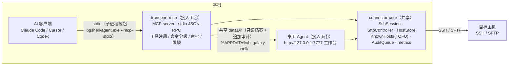

# BitGalaxy Shell AI 接入能力（MCP）· 正式设计稿

| 项 | 内容 |
|---|---|
| 文档版本 | v1.0 |
| 日期 | 2026-10-12 |
| 状态 | 已随 MA1 实装（待评审） |
| 范围 | Agent 侧 `packages/transport-mcp`（接入面④）+ connector-core exec 扩展 + Agent 入口 `--mcp-stdio` 子模式 |
| 上游文档 | `docs/shell-design.md`（总体架构 / 密钥模块 / 审计与数据目录沿用其约定） |
| 关联决策 | 协议=MCP；场景=本地 AI 客户端（Claude Code / Cursor / Codex 等）；安全=分级 + 白名单 + 人工审批（fail-closed） |

---

## 1. 背景与目标

### 1.1 需求

- **让 AI 代替人敲命令**：本地 AI 编码/运维客户端经标准协议直接使用 Shell 的主机运维能力（列主机、探测、执行命令、传文件、看指标）。
- **复用既有核心**：不新写数据面——SSH 建连、TOFU、SFTP、指标采集、审计全部复用 connector-core，MCP 只是第四种接入面（§2.2「一个 Agent 核心，三种接入面」扩展为四种）。
- **可控可审计**：AI 拥有对真实主机的操作权是高风险能力，必须分级放行、白名单调节、关键操作人工审批、全链路审计。

### 1.2 非目标（首版明确不做）

- 云端/远程 AI 接入（Streamable HTTP 传输 + 云端鉴权，列 MA2+；stdio 已覆盖本地客户端主场景）。
- PTY 交互式终端作为 AI 工具（AI 用一次性 `exec_command`，交互式会话仍归人类的工作台）。
- MCP 侧主机档案 CRUD（避免与桌面 Agent 双进程并发写 `hosts.json`；档案由人在工作台维护，DA5）。
- 工作台内嵌 AI 对话（工作台只做策略展示位，后续里程碑）。

---

## 2. 总体架构

### 2.1 架构图



### 2.2 设计原则

| 原则 | 说明 |
|---|---|
| 第四种接入面，同一核心 | transport-mcp 与 transport-ws 平级，依赖 connector-core 而非 SessionManager（无 PTY 语义），SSH/SFTP/TOFU/审计路径与人类通道完全同构 |
| 无人值守时 fail-closed | 所有需要"人的判断"的环节（首连 TOFU、危险命令、写操作审批）在无人可答时一律拒绝，绝不静默放行 |
| 分级 + 白名单 + 审批 | 工具按风险三级（R/W/X）注册；命令再经黑/白名单分类器；`ask` 级经 MCP elicitation 弹到 AI 客户端 UI 由人拍板 |
| AI 永不接触凭据 | 工具返回体不包含密码/私钥路径/口令；凭据仅在 SSH 握手瞬间使用（沿用 §6 密钥模块边界） |
| 一切留痕 | 每次工具调用（含被拒绝的）追加 `ai.tool` 审计事件到 `audit-queue.jsonl`，与人类会话审计同队列 |
| 共享不互斥 | 与桌面 Agent 共享 `dataDir`：档案/known_hosts **只读**，审计**追加写**（jsonl 天然并发安全），策略文件独立 |

---

## 3. 工具集

十个工具按风险三级注册。风险级：**R**=只读自动放行；**W**=写操作（策略开关 + 审批）；**X**=命令执行（命令分类器 + 审批）。

| 工具 | 风险级 | 入参（摘要） | 说明 |
|---|---|---|---|
| `list_hosts` | R | — | 主机档案清单（脱敏投影：id/name/host/port/username/tags/hostKeyKnown，**不含凭据**） |
| `probe_host` | R | hostId | TCP 连通性探测（2.5s 超时，不做 SSH 握手） |
| `get_metrics` | R | hostId | 单次指标采集（uptime/负载/内存/磁盘/top 进程，复用 metrics 命令与解析） |
| `list_dir` | R | hostId, path | SFTP 目录列表（名称/类型/大小/mtime） |
| `read_file` | R | hostId, path, offset?, maxBytes? | SFTP 读文本文件；上限受策略钳制（默认 256KB），超限截断并标注 |
| `exec_command` | X | hostId, command, timeoutMs? | 一次性非交互命令（ssh exec 通道）；经命令分类器（§4.2）；stdout+stderr+退出码；输出截断（默认 64KB） |
| `write_file` | W | hostId, path, content, mode? | SFTP 写文件（overwrite/append）；`write.enabled=false` 时整体禁用 |
| `make_dir` | W | hostId, path | SFTP 建目录 |
| `rename_path` | W | hostId, from, to | SFTP 改名/移动 |
| `delete_path` | W | hostId, path, recursive? | SFTP 删除（recursive 删目录树，审批文案显式标注） |

工具返回统一为文本（JSON 序列化），错误为结构化 `{ ok:false, code, message }`，AI 可读可自纠。`delete_path`/`exec_command` 审批文案必须包含目标主机、完整命令/路径与 recursive 标志。

---

## 4. 安全模型

### 4.1 决策流水线

```
工具调用 → 风险级闸门
  R  → 直接执行
  W  → write.enabled? → defaultAction(allow|ask|deny) → ask 则 elicitation 审批
  X  → 命令分类器 → deny / allow / ask(elicitation) 
全部路径 → 执行（或拒绝）→ ai.tool 审计事件
```

### 4.2 命令分类器（exec_command 专用）

优先级：**deny 黑名单 > allow 白名单 > defaultAction**。

- 黑名单命中 → 立即拒绝（审计 `decision=policy-denied`），内置不可删除的硬黑名单（§6 默认值）+ 用户可扩展。
- 白名单命中 → 直接执行（如 `^(systemctl|journalctl|docker|kubectl) (status|list|logs)` 类只读运维命令）。
- 其余 → `defaultAction`（默认 `ask`）。

匹配语义：按正则源串（`ai-policy.json`）、大小写不敏感、对完整命令字符串匹配。

### 4.3 人工审批（MCP elicitation）

`ask` 级动作向 AI 客户端发起 `elicitation/create` 请求（MCP 2025-06-18 起），客户端在原生 UI 弹出「允许 AI 执行 `rm -rf /tmp/build` 于 prod-01？」由人接受/拒绝。

- 客户端声明不支持 elicitation → **拒绝执行**，错误信息引导用户将该命令加入白名单（fail-closed）。
- 用户 decline/cancel/超时 → 拒绝。

### 4.4 TOFU fail-closed（MCP 不做首连确认）

无人值守通道不弹指纹确认：目标主机指纹不在 `known-hosts.json` 时，MCP 侧直接拒绝并提示「请先在工作台对该主机完成一次人工连接（TOFU 确认）」。指纹不匹配（疑似中间人）同样拒绝。known_hosts 由桌面工作台首连写入，两条通道共享。

### 4.5 限额与输出卫生

| 限额 | 默认 | 说明 |
|---|---|---|
| exec 超时 | 30s（入参可调，上限钳制） | 超时终止通道，返回已收输出 + timeout 标志 |
| exec 输出 | 64KB | 超限截断，标注 `truncated` |
| 单次读文件 | 256KB | 同上 |
| 连接池空闲 | 5min | 自动断开（§5） |
| 连接/命令内存上限 | 2MB | connector-core exec 采集硬顶，防超大输出撑爆内存 |

---

## 5. 连接池（McpHostPool）

- 按 `hostId` 复用一条 SSH 连接（`SshSession`，kind=exec，不开 PTY）；并发工具调用对同一 host 合并等待同一次建连。
- 空闲 TTL（默认 5 分钟）自动 `close`；出错/断开即逐出，下次调用重建。
- 建连失败错误结构化映射：凭据缺失 / 网络不可达 / 指纹未知 / 指纹不匹配，AI 可据此向用户求助而不是重试轰炸。

---

## 6. 策略文件 `ai-policy.json`（dataDir）

```jsonc
{
  "version": 1,
  "exec": {
    "enabled": true,
    "defaultAction": "ask",            // allow | ask | deny
    "allowPatterns": [],               // 正则源串数组，如 "^(systemctl|docker) (status|ps|logs)\\b"
    "denyPatterns": []                 // 追加到内置硬黑名单之后
  },
  "write": { "enabled": true, "defaultAction": "ask" },
  "limits": {
    "execTimeoutMs": 30000, "maxExecOutputBytes": 65536,
    "maxReadFileBytes": 262144, "idleCloseSec": 300
  }
}
```

内置硬黑名单（denyPatterns 之前匹配，永不可关）：

| 模式（语义） | 防护目标 |
|---|---|
| `rm -rf /`（含 `rm -fr /`、`/*` 变体，排除 `*` 通配安全的写法经白名单显式放行） | 根删除 |
| `mkfs`、`dd … of=/dev/…`、`> /dev/sd…` | 块设备毁灭 |
| `shutdown`、`reboot`、`halt`、`poweroff`、`init 0/6` | 关机重启 |
| fork 炸弹 `:(){ :\|:& };:` | 资源耗尽 |
| `chmod -R 777 /`、`chown -R … /`（根递归） | 权限破坏 |
| `curl/wget … | (ba)?sh`、`| sudo sh` 管道执行 | 远程脚本直执行 |

文件不存在时按上述默认值运行；损坏时回退默认并审计 `ai.policy-fallback`。策略文件由人手工编辑（MA1），工作台策略页列后续里程碑。

---

## 7. 审计事件（`audit-queue.jsonl` 追加）

```jsonc
{ "type": "ai.tool", "ts": "...", "tool": "exec_command", "hostId": "...",
  "client": "<clientId>/<clientVersion>", "decision": "allow | policy-denied | elicit-accepted | elicit-declined | elicit-unsupported",
  "detail": { "command": "df -h", "exitCode": 0, "truncated": false, "ms": 320 } }
```

被拒绝的调用同样留痕（detail.exitCode 为空）。命名沿用 §6.7 事件风格，M2 起与人类会话审计同队列补报云端。

---

## 8. 客户端接入配置

统一入口：`bgshell-agent.exe --mcp-stdio`（SEA 单文件）或开发态 `node apps/agent/dist/main.js --mcp-stdio`；环境变量 `BGSH_MCP=stdio` 等效。数据目录与桌面 Agent 一致（`BGSH_DATA_DIR` 可覆盖）。

Claude Code（项目 `.mcp.json`）：

```json
{
  "mcpServers": {
    "bgshell": { "command": "C:\\path\\to\\bgshell-agent.exe", "args": ["--mcp-stdio"] }
  }
}
```

Cursor / 通用 stdio 客户端同构（command + args）。stdio 通道内 MCP server 不向 stdout 打印任何日志（诊断走 stderr 与 `agent.log`）。

---

## 9. 里程碑

| 阶段 | 交付物 | 验收标准 |
|---|---|---|
| MA1（本次） | transport-mcp（10 工具 + 分类器 + elicitation 审批 + 连接池）+ connector-core exec 扩展（stderr/限额/截断）+ `--mcp-stdio` 入口 | Claude Code/Cursor 列出工具；只读工具直通；危险命令被硬黑名单拒绝；ask 命令弹出审批且拒绝后不执行；TOFU 未知主机被拒绝；审计落盘 |
| MA2 | Streamable HTTP 传输（127.0.0.1，与工作台同端口）+ 多客户端并发 | 远程开发容器中的 AI 客户端可接入 |
| MA3 | 工作台 AI 策略页（白名单编辑 / 审批日志查看）+ 密库联动（M2 后凭据解密路径统一） | 策略可视化治理 |
| MA4 | 云端 AI 网关（云端模型经中继调用，权限码 `shell:ai:*`） | 云端 AI 受权限与审计约束使用主机能力 |

---

## 10. 决策记录

| # | 决策 | 理由 |
|---|---|---|
| DA1 | 协议选 MCP（stdio） | 行业事实标准，Claude Code/Cursor/Codex/VS Code 原生支持，工具/审批（elicitation）语义完备；自定义 API 无生态 |
| DA2 | 复用 connector-core 而非 SessionManager | SessionManager 面向 PTY 流式会话；AI 需要 RPC 式一次性调用，直接用 SshSession(exec/sftp) 更薄更稳 |
| DA3 | 安全=分级 + 白名单 + elicitation 审批，fail-closed | 平衡自动化效率与破坏性风险；客户端不支持审批时拒绝而非放行 |
| DA4 | TOFU fail-closed（MCP 不做首连指纹确认） | 无人值守场景无人能核指纹；首连确认是人的职责，收敛到工作台 |
| DA5 | MCP 不提供主机档案 CRUD | 双进程并发写 hosts.json 有覆盖风险；档案含凭据，属人工治理对象 |
| DA6 | 连接按 hostId 池化复用 + 空闲 TTL | AI 多轮调用高频，逐次建连延迟与目标机负载都不可接受 |
| DA7 | exec 扩展落在 connector-core（stderr/限额/截断） | 采集硬顶（2MB）对 metrics/人类通道同样成立，属核心健壮性而非 MCP 私有 |
| DA8 | 策略文件独立于 settings.json | 策略可单独分发/审计；后续云端策略下发不污染本地桌面设置 |

---

## 11. 已知限制

| 限制 | 处置 |
|---|---|
| M1 凭据仍为 hosts.json 内联明文（沿既有现状） | M2 密库落地后 MCP 建连路径统一切换，接口不变（DA7） |
| elicititation 依赖客户端支持（Claude Code/Cursor 已支持） | 不支持即拒绝；白名单仍可让可信命令自动放行 |
| 多个 AI 客户端各自拉起 MCP 进程时连接池不共享 | 每进程独立池，空闲 TTL 收敛连接数；MA2 HTTP 传输后单进程共享 |
| 正则黑名单可被构造绕过（编码/换行/变量拼接） | 黑名单是纵深防御一层而非唯一防线；`ask` 默认级要求审批兜底；审计可追溯 |
| Windows 目标主机的 metrics 命令为 POSIX 语法 | 沿用 metrics 既有限制（Linux 目标为主） |
