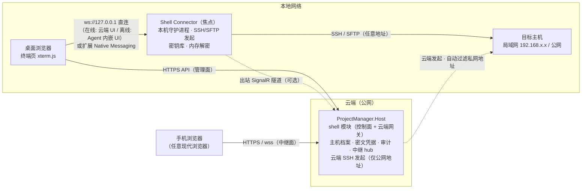
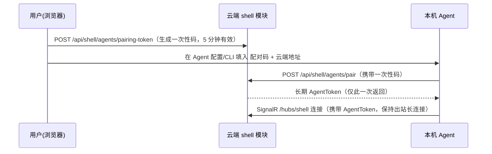
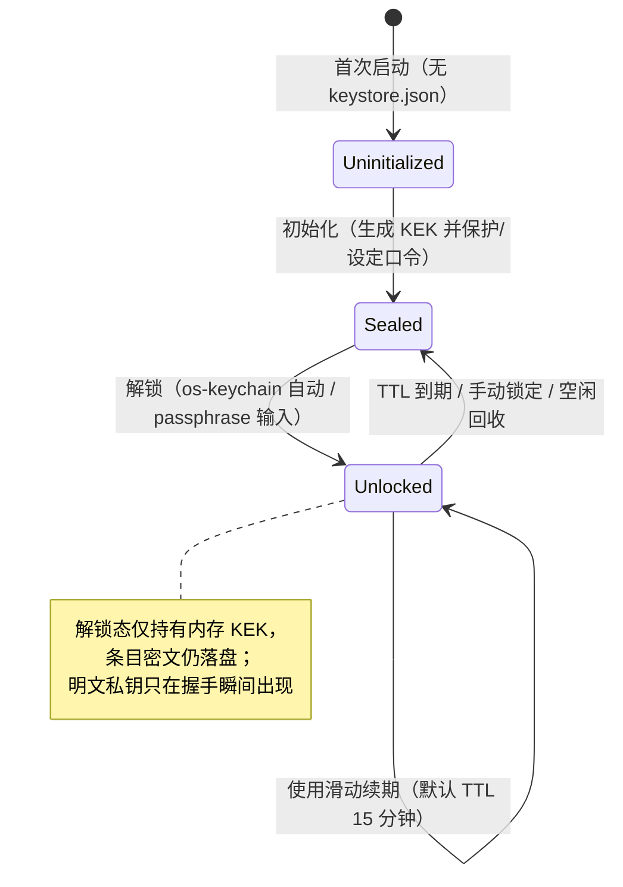

# BitGalaxy Shell 在线终端工具 · 正式设计稿

| 项 | 内容 |
|---|---|
| 文档版本 | v1.2 |
| 日期 | 2026-10-10 |
| 状态 | 待评审 |
| 范围 | 云端 shell 模块（ProjectManager 扩展）+ 本机 Agent（Shell Connector）+ 云端 SSH 网关 + 密钥管理模块 + 前端工作台 |
| 关联仓库 | `d:\sorce3\BitGalaxy.Shell`（Agent/协议/扩展）、`d:\source2\BitGalaxyProjectManager`（云端模块） |
| 变更记录 | v1.3：新增 AI 接入能力（接入面④ MCP，`packages/transport-mcp` + Agent `--mcp-stdio` 子模式），详设见 `docs/ai-design.md`；v1.2：新增离线模式与共享工作台 UI 选型——Agent 内嵌 Web 工作台（React+antd+xterm 同栈，workbench-ui 双宿主），无云环境完整可用（§1.1 / §2.2 / §3 / §5.1 / §5.4 / §7 / §10 / §11-D7）；v1.1：新增云端 SSH 网关与发起位置协商（§4.7） |

---

## 1. 背景与目标

### 1.1 需求

- **敲命令**：浏览器内交互式终端（xterm.js），多标签会话，连接局域网/公网 SSH 主机。
- **传文件**：SFTP 上传/下载/目录管理，进度与断点续传。
- **看运行状态**：主机连通性探测 + 系统指标面板（uptime/df/ps/docker）。
- **密钥管理**：SSH 凭据的导入/生成/加密存储/公钥分发/云端密文备份，含解锁过期策略。
- **多端使用**：桌面浏览器（Chrome/Edge）直连；手机/远程经云端中继。
- **无 Agent 也可用**：本机未安装 Agent 时，由云端网关对公网可达主机直接发起 SSH（私网地址自动过滤）。
- **离线可用**：无云环境（断网/云端不可达）下，Agent 内嵌工作台提供终端、SFTP、指标、密钥管理等基本能力（本地主机档案 + 本地密库，§5.4）。

### 1.2 核心约束

1. **连接发起位置协商（本机优先）**：局域网主机只能由本机 Agent 发起（浏览器不能开原始 TCP，云端不可达私网）；本机无 Agent 时可对**公网可达主机**由云端网关发起，且**自动过滤私有网段地址**——云端不可达，亦防误连云厂商内网/元数据端点。
2. **云端不见明文密钥（范围收窄）**：云端只保存 AEAD 密文、指纹、公钥与审计元数据；云端发起的会话仅可使用 `ServerManaged` 凭据（服务端可解密），`E2ePassphrase` 条目的 KEK 在用户口令中、永不上云，仅限本机 Agent 使用。

### 1.3 非目标（首版明确不做）

- 会话录屏回放（仅记录审计元数据与可选命令文本）。
- Safari 的直连模式（`ws://127.0.0.1` 混合内容豁免仅 Chrome/Edge/Firefox；Safari 走中继/云端发起可用）。
- 本机恶意软件防护（超出任何本机 Agent 方案的能力边界，见 §8 威胁模型）。

---

## 2. 总体架构

### 2.1 架构图



### 2.2 设计原则

| 原则 | 说明 |
|---|---|
| 控制面/数据面分离 | 云端做档案、授权、审计与转发；数据面有两个发起方——本机 Agent（全地址）与云端网关（仅公网地址） |
| 发起位置协商 | 打开会话前先探测本机 Agent：在线则本机发起（覆盖含私网在内的全部主机）；不在线则云端网关发起（自动过滤私有网段）；用户可显式指定 `local` / `cloud` |
| 离线优先降级 | 云端不可达时自动降级：Agent 内嵌工作台 + 本地主机档案 + 本地密库，核心操作能力不依赖云端；审计本地暂存、联网补报（§5.4） |
| 一个 Agent 核心，多种接入面 | `ws://127.0.0.1` 直连、扩展 Native Messaging、云端 SignalR 中继、MCP（AI 客户端，docs/ai-design.md），传输层可插拔，核心（SSH 会话/SFTP/密钥库/审计上报）一份代码 |
| 密钥只在一处明文 | 私钥明文仅存在于握手瞬间（本机 Agent 内存，或云端网关的 `ServerManaged` 解密路径）；落盘必为 AES-256-GCM 密文 |
| 方向恒定（Agent 侧） | Agent→云端只做出站连接（中继隧道/同步/审计），云端永不主动连入本机 |

---

## 3. 仓库与工程布局

```
d:\sorce3\BitGalaxy.Shell            # 本仓库（Agent 侧）
  packages/
    connector-core/                   # 核心：会话管理/密钥库/审计，传输无关
    transport-ws/                     # 接入面 ①：127.0.0.1 WebSocket 服务
    transport-nm/                     # 接入面 ②：Native Messaging host 入口（stdio）
    transport-relay/                  # 接入面 ③：SignalR 出站客户端
    transport-mcp/                    # 接入面 ④：MCP server（AI 客户端工具集，docs/ai-design.md）
    protocol/                         # @bgshell/protocol：前后端共享帧/类型定义
    workbench-ui/                     # 共享工作台 UI（React+antd+xterm）：终端/SFTP/指标/密钥管理界面，双宿主部署
  apps/
    agent/                            # Agent 入口（数据目录 + 启动装配）
    extension/                        # MV3 浏览器扩展（Chrome/Edge 通用，规划 M5）
    desktop/                          # Tauri 2 桌面壳（D9）：主窗口工作台 + 托盘 + agent sidecar；宠物窗规划 P2
  docs/

d:\source2\BitGalaxyProjectManager    # 云端模块（遵循既有模块惯例）
  packages/shell/
    backend/                          # ShellModule : IModule（ProjectManager.Shell.csproj）
    frontend/                         # @pm/shell（manifest + pages + api）
```

---

## 4. 云端 shell 模块（ProjectManager 侧）

### 4.1 实体与状态机

`ShellDbContext`（Npgsql，迁移表 `__EFMigrationsHistory_Shell`，与既有模块一致）。

**SshHost（主机档案）**

| 字段 | 类型 | 说明 |
|---|---|---|
| Id | Guid | 主键 |
| Name | string | 显示名 |
| Host / Port / Username | string / int / string | 连接参数（Port 默认 22） |
| AuthMethod | enum | `Password` / `PrivateKey` / `Agent` |
| CredentialId | Guid? | 引用 ShellCredential（AuthMethod=PrivateKey/Password 时必填） |
| Tags | string[] | 分组标签 |
| ProjectId | Guid? | 可选挂接 projects 模块 |
| OwnerUserId | Guid | 归属 |
| HostKeyFingerprint | string? | 首连确认（TOFU）后记录，后续校验 |
| ReachScope | enum | `Auto`（默认，按地址分类）/ `LocalOnly`（仅本机发起）/ `CloudEligible`（显式标记云端可连，如经 VPN/端口映射暴露的私网地址） |
| LastProbeAt / LastProbeResult | DateTime? / enum | 探测回填（在线 Agent 优先执行，否则云端网关）：`Unknown/Reachable/Unreachable` |

**ShellCredential（凭据，密文存储）**

| 字段 | 类型 | 说明 |
|---|---|---|
| Id / Name | Guid / string | |
| Type | enum | `Password` / `PrivateKey` |
| Algorithm | string? | `ssh-ed25519` / `ssh-rsa` … |
| Fingerprint | string | `SHA256:...`（查重与展示） |
| PublicKey | string? | 公钥明文（仅 PrivateKey 类型；用于分发展示，可公开） |
| SecretEnvelope | json | AEAD 密文封套（§6.7），**任何 API 永不回传** |
| KekMode | enum | `ServerManaged` / `E2ePassphrase` |
| OwnerUserId / ProjectId? | Guid / Guid? | 授权范围 |
| LastUsedAt | DateTime? | Agent/网关上报回填 |

状态机：无（软删遵循平台惯例）。被 SshHost 引用的凭据拒删。

**AgentRegistration（Agent 注册）**

| 字段 | 说明 |
|---|---|
| Id / AgentKey | 设备唯一标识（Agent 首次启动生成，持久本地） |
| OwnerUserId | 归属用户（中继路由依据） |
| DeviceName / Version | 展示与升级提示 |
| Status / LastSeenAt | `Online/Offline`，由 SignalR hub 连接/断开维护 |
| TokenHash | 长期 AgentToken 哈希（配对换取，可吊销 RevokedAt） |

配对流程：



**ShellSessionAudit（会话审计）**

| 字段 | 说明 |
|---|---|
| Id / UserId / HostId / AgentId | 谁、连了哪台、经哪个 Agent（云端发起时 AgentId 为空） |
| ClientMode | `Direct` / `Extension` / `Relay` / `Cloud`（云端网关发起） |
| StartedAt / EndedAt / ExitReason | 生命周期 |
| BytesIn / BytesOut | 流量（中继/云端会话由服务端统计；直连模式由 Agent 上报） |

### 4.2 API 路由

遵循平台约定：`[Authorize]` + `[RequirePermission]`、`ApiResponse<T>`、枚举字符串序列化、分页 pageSize 1–100。

| 方法 | 路径 | 权限 | 说明 |
|---|---|---|---|
| GET | `/api/shell/hosts` | `shell:read` | 分页（keyword / tag / projectId） |
| POST / PUT / DELETE | `/api/shell/hosts`（`/{id}`） | `shell:admin` | 档案 CRUD |
| GET | `/api/shell/hosts/{id}/status` | `shell:read` | 最近探测结果 |
| POST | `/api/shell/hosts/{id}/probe` | `shell:write` | 触发连通性探测（在线 Agent 优先，否则云端网关；结果回填状态） |
| GET | `/api/shell/credentials` | `shell:read` | 列表（不含密文） |
| POST / PUT / DELETE | `/api/shell/credentials`（`/{id}`） | `shell:admin` | 写入为 write-only；被主机引用拒删 |
| GET | `/api/shell/credentials/{id}/public-key` | `shell:read` | 公钥明文（分发确认用） |
| POST | `/api/shell/hosts/{id}/deploy-public-key/{credentialId}` | `shell:admin` | 下发公钥部署指令（经 Agent 执行，§6.6） |
| GET | `/api/shell/agents` | `shell:read`(自己的) / `shell:admin`(全部) | 在线状态 |
| POST | `/api/shell/agents/pairing-token` | `shell:write` | 一次性配对码 |
| POST | `/api/shell/agents/pair` | 配对码持有者 | 换取长期 AgentToken（非用户 JWT 通道） |
| DELETE | `/api/shell/agents/{id}` | `shell:admin` | 吊销 |
| GET | `/api/shell/sessions`（`/{id}`） | `shell:read` | 审计查询（admin 可跨用户） |

### 4.3 权限码（`IPermissionSeeder` 自播种）

| 权限码 | 说明 |
|---|---|
| `shell:read` | 查看主机/凭据列表/会话审计 |
| `shell:write` | 建立终端会话（本机发起或云端发起）、传输文件、探测、生成配对码 |
| `shell:admin` | 管理主机档案、凭据、Agent 注册与授权分配、ReachScope 覆盖 |

### 4.4 中继 Hub（SignalR，`/hubs/shell`）

nginx `/hubs/` 反代与 vite `/hubs` 代理已预留，零基础设施改造。

- **分组**：`agent:{agentId}`、`user:{userId}`。
- **认证**：浏览器侧走用户 JWT；Agent 侧走 AgentToken。
- **核心方法**：
  - 浏览器 → Hub：`OpenSession(hostId, agentId?, opts)`（`opts.origination = auto | local | cloud`；服务端校验 `shell:write` 与主机归属，按 §4.7 协商规则路由：转发该用户在线 Agent，或落入云端网关会话）、`Relay(sessionId, frame)`。
  - Hub → Agent：`OpenSession(sessionId, hostSnapshot, opts)`、`Relay(sessionId, frame)`。
  - Agent → Hub：`Relay(sessionId, frame)`、`ReportProbe(hostId, result)`、`ReportAudit(events[])`。
- **服务端职责边界**：转发不解析 frame 载荷；仅做权限校验、路由、字节数计量与会话生命周期登记。

### 4.5 凭据加密与 KEK 模式

| 模式 | KEK 位置 | 适用 | 代价 |
|---|---|---|---|
| `ServerManaged`（默认） | 服务端主密钥文件 `keys/shell-master.key`（自动生成，部署备份；先例：licensing 私钥 `keys/licensing-private-key.pem`） | 团队共享凭据、换机即用；**云端发起会话的唯一可用模式** | 云端被完全攻破时密文可解 |
| `E2ePassphrase` | 用户口令 scrypt 派生，永不上云 | 个人敏感密钥；仅限本机 Agent 发起的会话 | 换机/重装须输口令；口令丢失不可恢复（UI 必须明示） |

写入 API 对两种模式语义一致：`ServerManaged` 时客户端传明文 secret（TLS 通道内），服务端加密入库；`E2ePassphrase` 时客户端本地完成加密，仅上传密文封套（服务端原样存储）。

### 4.6 配置（appsettings.json）

```jsonc
"Modules": { "Enabled": [ "...", "shell" ] },
"Shell": {
  "Relay": { "Enabled": true },
  "Gateway": { "Enabled": true, "ConnectTimeoutSec": 10, "MaxConcurrentSessions": 20 },
  "Encryption": {
    "KekMode": "ServerManaged",
    "MasterKeyPath": "keys/shell-master.key"
  },
  "Pairing": { "TokenTtlMinutes": 5 },
  "Audit": { "CommandRecording": "off" }   // off | metadata | full（默认 off，full 需显式合规确认）
}
```

### 4.7 云端 SSH 网关（云端发起）

**库选型**：`Renci.SshNet`（SSH.NET，PTY / SFTP / exec 成熟，版本登记 `Directory.Packages.props`）。

**发起协商规则（OpenSession 时服务端执行）**：

```
origination = local   → 必须存在该用户的在线 Agent，否则报错
origination = cloud   → 必须通过私网地址过滤（见下），且主机凭据为 ServerManaged
origination = auto（默认）：
  1. 探测到用户有在线 Agent → 本机 Agent 发起（任意地址，含私网）
  2. 无在线 Agent           → 云端网关发起；地址分类为 Private 且 ReachScope ≠ CloudEligible
                               → 拒绝并在 UI 提示"该主机需本机 Agent"
```

**私网地址自动过滤（云端发起的前置校验）**：

| 网段 / 情形 | 处理 |
|---|---|
| `10.0.0.0/8`、`172.16.0.0/12`、`192.168.0.0/16` | 拒绝（云端不可达；亦为云厂商内网常见段，防误连） |
| `127.0.0.0/8`、`169.254.0.0/16`（含云元数据 `169.254.169.254`） | 拒绝（环回/链路本地，SSRF 防护） |
| `100.64.0.0/10`（CGNAT）、IPv6 `fc00::/7`、`fe80::/10`、`::1` | 拒绝 |
| 域名 | 服务端 DNS 解析后按结果分类；解析失败视为不可云端发起 |
| 公网地址，或 `ReachScope = CloudEligible`（`shell:admin` 显式标记） | 允许 |

**会话实现**：网关会话与 Agent 会话共用同一 `SessionFrame` envelope（§5.2），Hub 在服务端直接消费/产生帧；审计 `ClientMode=Cloud`；SFTP/指标帧语义完全一致，前端无感知发起方差异。

**边界与限制**：

- 云发起仅支持 `ServerManaged` 凭据（`E2ePassphrase` 条目 KEK 在用户口令中，服务端无法解密）。
- 云服务器需具备到目标主机 SSH 端口的出站网络（安全组/防火墙放行）。
- 配置开关 `Shell:Gateway:Enabled=false` 可整体关闭云端发起能力（退回 v1.0 的"全部本地发起"语义）。

---

## 5. Agent（Shell Connector）

### 5.1 进程模型与传输层

- Node.js ≥ 20，核心依赖 `ssh2`（PTY/exec/SFTP）、`@bgshell/protocol`（与前端共享类型）。
- 传输层接口（connector-core 对外唯一暴露）：

```ts
interface Transport {
  // 页面/扩展/中继侧到 Agent 的会话通道
  onSessionOpen(cb: (req: OpenSessionRequest) => Promise<SessionHandle>): void
  onControl(cb: (msg: ControlMessage) => Promise<void>): void   // 探测/同步/锁定等
  start(): Promise<void>
  stop(): Promise<void>
}
```

- 传输实现：`transport-ws`（监听 `127.0.0.1`，Origin 白名单=云端域名 + 一次性会话令牌）、`transport-nm`（stdio length-prefixed 帧，由扩展拉起）、`transport-relay`（SignalR 出站客户端）、`transport-mcp`（MCP stdio，AI 客户端工具集——不经会话帧协议，直用 connector-core，见 docs/ai-design.md）。
- 直连模式的令牌握手：页面先经云端 `POST /api/shell/session-tokens` 取短时令牌（30s），Agent 校验令牌签名与 Origin —— 防止任意网页驱动本机 Agent。
- **内嵌工作台（离线 UI）**：transport-ws 同端口提供 HTTP 服务（`http://127.0.0.1:7777`），托管 `workbench-ui` 的静态构建；离线打开即为完整工作台（本地 `hosts.json` 主机档案 + 本地密库），在线时同一 UI 亦由云端 `@pm/shell` 托管——**一套 UI、两个宿主**。本地打开的页面与 `ws://` 同源，无混合内容问题。

### 5.2 会话与帧协议（三种传输统一 envelope）

```jsonc
// 控制帧（文本）
{ "s": "<sessionId>", "t": "open",    "m": { "hostId": "...", "cols": 120, "rows": 32, "term": "xterm-256color", "origination": "auto" } }
{ "s": "<sessionId>", "t": "resize",  "m": { "cols": 120, "rows": 32 } }
{ "s": "<sessionId>", "t": "close",   "m": { "reason": "user" } }
{ "s": "<sessionId>", "t": "sftp",    "m": { "op": "ls|stat|mkdir|rm|rename|uploadOpen|uploadChunk|uploadClose|downloadOpen|downloadChunk|downloadClose", ... } }
{ "s": "<sessionId>", "t": "metrics", "m": { "intervalSec": 10, "collectors": ["uptime", "df", "ps", "docker"] } }
// 数据帧（二进制，首字节类型 + 载荷）
// 0x01 stdout   0x02 stdin   0x03 stderr
// 0x10 sftp 上传块   0x11 sftp 下载块   0x12 sftp 进度
// 0x20 metrics JSON
```

`origination` 仅经中继/云端路径生效（直连/NM 恒为 `local`）。NM 传输将上述帧 base64 后包入 Native Messaging 标准帧；中继传输原样走 SignalR `Relay`。帧语义单一定义，三面复用。

### 5.3 会话生命周期

1. `open` → 从本地缓存/云端拉取主机快照（含凭据密文）→ 密库解密（§6.5）→ `ssh2` 建连（PTY）。
2. 主机指纹按 `HostKeyFingerprint` 校验；首连 TOFU 确认后回写云端档案。
3. `close` 或传输断开 → 关闭 SSH 通道 → 上报会话审计（时长/流量/ExitReason）。

### 5.4 离线模式（能力降级矩阵）

| 能力 | 在线（云端可达） | 离线（云端不可达） |
|---|---|---|
| 终端 / SFTP / 指标 | ✓ | ✓（本地档案 + 本地密库） |
| 工作台 UI 入口 | 云端 `@pm/shell` 或本机内嵌 | 本机内嵌 `http://127.0.0.1:7777` |
| 主机档案 | 云端为主，本地缓存 | `hosts.json` 本地档案（可离线新建/修改） |
| 凭据 | 云端密文 + 本地密库同步 | 仅本地密库（托管/E2E 条目均可本地使用） |
| 审计 | 实时上报 | 本地暂存（`audit-queue.jsonl`），联网后补报 |
| 云端发起 / 中继 / 配对 / 凭据云端备份 | ✓ | 不可用（入口自动隐藏，恢复联网后自动重试） |

档案与审计的同步策略：本地 `hosts.json` 与云端档案按 `updatedAt` 合并（最后写胜出 + 冲突提示）；离线审计补报携带原始时间戳。

---

## 6. 密钥管理模块（Agent 内，详设）

**职责定位**：Agent 密库是密钥的唯一运行时主体；云端只持有密文副本（备份/分发）与治理元数据。四来源（导入/生成/系统 ssh-agent/云端恢复）汇入密库，两出口（握手解密、公钥分发）。

### 6.1 存储结构

```
%APPDATA%/bitgalaxy-shell/          # Win；macOS ~/Library/Application Support/；Linux ~/.config/
  keystore/
    keystore.json                   # 元数据 + 密文条目（见下）
    master.key.protected            # OS 钥匙串模式：DPAPI blob（passphrase 模式无此文件）
```

`keystore.json`：

```jsonc
{
  "version": 1,
  "kekMode": "os-keychain",         // os-keychain | passphrase
  "kdf": { "algo": "scrypt", "N": 16384, "r": 8, "p": 1, "salt": "<b64>" },  // 仅 passphrase 模式使用
  "entries": [
    {
      "id": "<uuid>",
      "alias": "prod-jump",
      "kind": "private-key",        // private-key | password | agent-ref
      "algorithm": "ssh-ed25519",
      "fingerprint": "SHA256:...",
      "publicKey": "ssh-ed25519 AAAA...",   // 私钥类条目明文公钥
      "secret": { "nonce": "<b64 12B>", "ct": "<b64>", "tag": "<b64>" },  // AES-256-GCM，AAD=entry.id
      "source": "import | generated | cloud | agent",
      "createdAt": "...", "lastUsedAt": "..."
    }
  ],
  "knownHosts": [ { "host": "192.168.1.10", "keyType": "ssh-ed25519", "keyBase64": "..." } ]
}
```

写入策略：原子写（临时文件 + rename），文件权限 600（尽力）。

### 6.2 主密钥（KEK）保护层级

| 层级 | 实现 | 说明 |
|---|---|---|
| 首选：OS 钥匙串 | Windows DPAPI（`CryptProtectData`，绑定当前登录用户）/ macOS Keychain / Linux libsecret | KEK 随机 32B，保护后落 `master.key.protected`；无需用户输口令 |
| 退化：口令派生 | scrypt(N=16384, r=8, p=1, salt 随机) → 32B KEK | 零原生依赖（纯 JS 可用）；每次解锁需口令 |

Node 原生绑定选型：DPAPI 优先 prebuilt 的 `win-dpapi` 类绑定；若依赖链不可接受，自动降级 passphrase 模式（安装期探测，UI 明示当前模式）。

### 6.3 密库状态机



参数：`unlockTtlMinutes=15`（滑动窗口，每次成功使用刷新）；`lockOnSuspend=true`（尽力监听系统事件）；直连页面提供"锁定密库"按钮即时回收。

### 6.4 四来源入口

| 来源 | 流程 |
|---|---|
| 导入 | 读 PEM/PPK 文本（含 passphrase 解密）→ `ssh2.utils.parseKey` → 计算指纹 → 入库（密文） |
| 生成 | `node:crypto.generateKeyPair('ed25519' | 'rsa', …)` + OpenSSH 格式封装（自写序列化或调用系统 `ssh-keygen`，Win10+ 自带）→ 入库 → 可直接触发公钥分发 |
| 系统 ssh-agent | 作为 `agent-ref` 条目登记来源（Windows named pipe / `SSH_AUTH_SOCK`），使用时经 agent 协议签名，私钥不进密库 |
| 云端恢复 | 拉取用户可见凭据密文清单 → `E2ePassphrase` 条目需口令解密后重新以本地 KEK 加密入库；`ServerManaged` 条目由服务端解密后经 TLS 下发再本地加密 |

### 6.5 使用与内存策略

1. 会话 open → 定位条目 → 若密库 Sealed 且 `kekMode=passphrase` → 向页面发起解锁请求 → 解密。
2. `ssh2.connect({ privateKey: decryptedBuffer, … })`；**握手成功后立即 `buffer.fill(0)` 并释放引用**（best-effort，文档明确 JS 环境无法保证严格 zeroize）。
3. 密码类条目经 `password` 回调按需提供，同样握手后释放。
4. 每次成功使用回填 `lastUsedAt` 并上报审计事件。

### 6.6 公钥分发（部署 authorized_keys）

前置：目标主机已有任一可用凭据（宿主凭据）。流程：

1. 经宿主凭据建立临时 SFTP/exec 通道。
2. 读取 `~/.ssh/authorized_keys`，按公钥行匹配（指纹比对）判断是否已存在。
3. 不存在则追加一行：`<pubkey> # bitgalaxy:<alias>`。
4. 尽力修正权限：`~/.ssh` 700、`authorized_keys` 600。
5. 关闭临时通道，上报 `key.deployed` 审计。

幂等性：按指纹去重，重复执行无副作用。失败场景（无宿主凭据/目录缺失）返回结构化错误，UI 引导。

### 6.7 云端同步契约与密文封套

**AEAD 封套（云端与本地同构）**

```jsonc
{ "v": 1, "kdf": { "algo": "scrypt", "N": 16384, "r": 8, "p": 1, "salt": "<b64>" },   // E2E 模式
  "nonce": "<b64 12B>", "ct": "<b64>", "tag": "<b64>", "aad": "<credentialId>" }      // AES-256-GCM
```

- `ServerManaged`：kdf 省略，云端以主密钥加解密。
- `E2ePassphrase`：客户端加密，云端原样存储 kdf + 封套。

**同步 API（复用 §4.2 凭据路由 + Agent 侧补充）**

| 方法 | 路径 | 说明 |
|---|---|---|
| GET | `/api/shell/credentials/sync-manifest` | Agent 拉取可见凭据的 `{id, fingerprint, updatedAt, kekMode}` 清单（无密文） |
| GET | `/api/shell/credentials/{id}/secret` | Agent 持用户 JWT 拉取密文封套（`ServerManaged` 时服务端解密返回，审计留痕） |
| POST | `/api/shell/credentials/{id}/used` | 上报使用（回填 LastUsedAt + 审计） |

**审计事件（Agent 上报，经 REST 或中继 hub）**

```jsonc
{ "type": "key.imported | key.generated | key.unlocked | key.used | key.deployed | session.opened | session.closed",
  "ts": "...", "userId": "...", "agentId": "...",
  "credentialId": "...?", "hostId": "...?", "meta": { "fingerprint": "...", "result": "ok" } }
```

命令内容记录默认 `off`（§4.6），开启 `full` 需管理员显式操作并进入审计。

### 6.8 已知限制（密钥模块）

| 限制 | 处置 |
|---|---|
| 无法防御本机恶意进程读取解锁态密钥 | 解锁 TTL + 空闲回收把暴露窗口压到最小；高敏密钥建议 `E2ePassphrase` + 用后手动锁定 |
| JS/Go 均无法严格内存清零 | best-effort 覆写 + 缩短驻留；与系统 ssh-agent 同等水平 |
| 原生钥匙串绑定维护风险 | 保留纯 JS passphrase 退化路径，安装期自动探测降级 |
| 云端发起无法使用 E2E 凭据 | 架构性限制（KEK 在用户口令中）；UI 在主机档案处标注凭据可用发起方 |

---

## 7. 前端（共享 workbench-ui + 云端壳 `@pm/shell`）

**选型（D7）**：UI 与 ProjectManager 完全同栈——React 19 + antd 6 + `@xterm/xterm`。终端工作台、SFTP、指标、密钥管理界面沉淀在 `packages/workbench-ui` 共享包，**双宿主部署**：Agent 内嵌（离线可用）与云端 `@pm/shell`（治理页面壳）。否决 Electron/Tauri（交付重、与"浏览器在线工具"定位重复，见 D7）。

| 页面/路由 | 权限 | 内容 |
|---|---|---|
| `/shell/hosts` 主机管理 | `shell:read` | 表格（标签/项目筛选）+ 探测状态徽标；CRUD 需 `shell:admin` |
| `/shell/credentials` 密钥库 | `shell:read` | 条目列表（指纹/算法/KekMode/最后使用）；导入/生成/删除；"部署公钥到主机"动作 |
| `/shell/terminal` 终端工作台 | `shell:write` | 左侧主机树（可达性徽标：本机 ✓ / 云端 ✓ / 仅本机）+ 右侧 xterm 多标签（复用宿主 TabBar 语义）；SFTP 抽屉（拖拽上传/进度/目录管理）；指标卡片（连通性/uptime/df/top 进程/docker） |
| `/shell/agents` Agent 管理 | `shell:read` | 在线状态/版本/配对弹窗（展示一次性配对码）；吊销需 `shell:admin` |

- manifest 挂"平台与工具"分组（`navGroups.nav-platform` 追加 `shell`）。
- 组件导出：`HostPicker`、`CredentialPicker`（供其他模块复用，如项目详情页直连主机）。
- **连接发起协商（页面加载时执行，结果缓存于工作台状态）**：
  1. 探测本机 Agent：直连握手（`ws://127.0.0.1:7777` + 会话令牌）→ 失败尝试扩展 NM → 再查询云端该用户 Agent 在线状态（中继通道）。
  2. 探测到 Agent → 全部主机可连（本机发起，含私网地址）；未探测到 → 仅公网/`CloudEligible` 主机可连（云端发起），私网地址主机**自动置灰**并提示"需本机 Agent"。
  3. 会话建立顺序：直连 → 扩展 NM → 云端中继（有 Agent 时）或云端网关（公网主机；用户可显式强制 `cloud`）。

---

## 8. 安全设计汇总

| 威胁 | 对策 |
|---|---|
| 任意网页驱动本机 Agent（跨站 WebSocket 劫持） | 直连服务仅监听 `127.0.0.1`；Origin 白名单（云端域名）；30s 一次性会话令牌（云端签发、Agent 校验签名） |
| 云端数据库泄露 | 凭据 AEAD 密文；`E2ePassphrase` 条目 KEK 不在云端；secret 字段任何 API 不回传 |
| 云端发起误连内网（SSRF 类） | 私网/环回/链路本地/CGNAT 网段硬过滤（§4.7，含云元数据端点）；显式覆盖需 `ReachScope=CloudEligible` + `shell:admin` |
| 云端网关凭据暴露面 | 云发起仅限 `ServerManaged` 凭据；网关会话全量审计（`ClientMode=Cloud`）；`Shell:Gateway:Enabled` 一键关闭 |
| 中继链路窃听 | 全程 TLS（wss）；帧载荷对中继服务器不透明（终端数据本体不加密的中继模式在 UI 标注风险，可开启端到端帧加密作为后续增强） |
| Agent 冒充/滥用 | 配对一次性码 + 长期 Token 哈希存储 + 可吊销；中继 OpenSession 做用户权限与主机归属双重校验 |
| 凭据横向越权 | `shell:admin/write/read` 三级权限 + 主机/凭据 OwnerUserId/ProjectId 授权范围 |
| 密钥滥用无痕 | 全链路审计事件（解锁/使用/分发/会话），云端可查 |

---

## 9. 兼容性与限制

- 浏览器：Chrome/Edge（直连 + 扩展 + 中继 + 云端发起）、Firefox（直连 + 中继 + 云端发起）、Safari（中继 + 云端发起）、移动端浏览器（中继 + 云端发起）。
- OS：Agent 首发支持 Windows（用户主力平台），密库路径与 DPAPI 已按三平台预留。
- 云端发起：需云服务器到目标主机 SSH 端口出站可达；NAT 后无私网映射的主机被自动排除（过滤规则见 §4.7）。
- 传输大小：SFTP 分块默认 64KB/帧；nginx `client_max_body_size 512m` 不构成约束（流式分块不走 /api）。

---

## 10. 里程碑

| 阶段 | 交付物 | 验收标准 |
|---|---|---|
| M1 直连 MVP | connector-core + transport-ws + workbench-ui 内嵌工作台（xterm 多标签，主机列表本地 hosts.json） | 本机浏览器敲命令打通局域网主机；**断网状态下工作台完整可用**；TOFU 指纹确认 |
| M2 云端模块 + 密钥管理 | ShellModule（hosts/credentials/agents/audit）+ 云端壳挂载 workbench-ui + Agent 密库（四来源/状态机/公钥分发） | 云端建档→Agent 同步→密钥连接全链路；云端 UI 与内嵌 UI 同源组件；解锁过期策略生效 |
| M3 文件与指标 | SFTP 完整操作 + 拖拽上传下载 + 指标面板 | 传 100MB 文件进度准确；指标 10s 刷新 |
| M4 云端网关 | SSH.NET 网关会话 + 私网地址过滤 + 发起位置协商（前端探测 Agent） | 无 Agent 的浏览器可连公网主机；私网主机自动置灰提示；E2E 凭据云端发起被正确拒绝 |
| M5 扩展形态 | MV3 扩展 + transport-nm + host 注册安装器 | 商店式安装后免直连端口，桌面主用形态 |
| M6 中继多端 | transport-relay + hub 路由 + 手机端工作台适配 | 手机浏览器经中继操作局域网主机；审计完整 |

---

## 11. 决策记录（默认采纳，可推翻）

| # | 决策 | 理由 |
|---|---|---|
| D1 | 连接模式：直连优先，中继排 M6 | 本地闭环延迟最低、云端零改造先行 |
| D2 | Agent 技术栈：Node.js + ssh2 | 与前端共享 TS 协议类型；密钥生态短板以退化路径补齐（§6.2） |
| D3 | 密钥托管：`ServerManaged` 默认 + `E2ePassphrase` 可选；Agent 本地密库为主体 | 团队易用与个人高敏可兼得 |
| D4 | 审计命令记录默认 `off` | 隐私优先，开启 `full` 需显式合规动作 |
| D5 | 扩展与中继共用同一 Agent 核心 | 核心代码一份，传输层可插拔 |
| D6 | 云端网关：允许云端直接发起 SSH（仅公网地址 + `ServerManaged` 凭据 + 私网硬过滤）；发起位置 `auto` 协商、本机优先 | 无 Agent 场景零门槛可用；地址过滤同时充当 SSRF 防护；`Gateway:Enabled` 可整体回退 |
| D7 | Agent UI 选型：内嵌 Web 工作台（Node 静态托管，HTTP+WS 同端口 7777），`workbench-ui` 共享包双宿主（Agent 内嵌 / 云端 `@pm/shell`）；否决 Electron/Tauri | 离线可用 + 一套 UI 两个宿主 + 与 PM 前端同栈零学习成本；Electron/Tauri 交付重且与"浏览器在线工具"定位重复 |
| D8 | 桌面打包：Node SEA 单文件 `bgshell-agent.exe`（esbuild bundle + postject + PE GUI 子系统，工作台资源内嵌）；后台运行=GUI 无黑窗，控制入口在工作台 UI（agent 控制帧：自启/启动打开/退出）；单实例互斥（端口占用→引导到现有实例） | 一键双击启动零运行时依赖；不引入 Electron 重量壳；托盘图标列为后续增强 |
| D9 | 桌面壳升级 Tauri 2（修订 D7 的"浏览器壳"结论）：`apps/desktop` = 主窗口（工作台第三宿主）+ 系统托盘 + bgshell-agent sidecar（--silent 拉起、随壳退出）；关闭主窗=隐藏到托盘；P0 过渡方案为 Edge/Chrome `--app` 模式独立窗口。宠物窗（透明/置顶/事件气泡，规划 P2）作为 Tauri 第二窗口实现 | 用户明确要桌面程序与桌面宠物形态；Tauri 常驻内存 ~60-120MB（WebView2 共享），宠物 web 动画生态全量可用，优于 Electron（150-250MB）；Agent/工作台代码零改动复用 |

---

## 12. 实施期文档义务（工作区规则回填）

- 云端 `packages/shell` 建立时：按规则补录 `d:\source2\BitGalaxyProjectManager\docs\bitgalaxy2-modules.md`（§3 总索引、§4 后端详情、§6 前端导出、§9/§10 速查与能力缺口），并回填 `docs/worklog/` 与 `docs/system-completion-status.md`。
- Agent 侧每个里程碑在 `d:\sorce3\BitGalaxy.Shell\docs\` 追加实施纪要。
